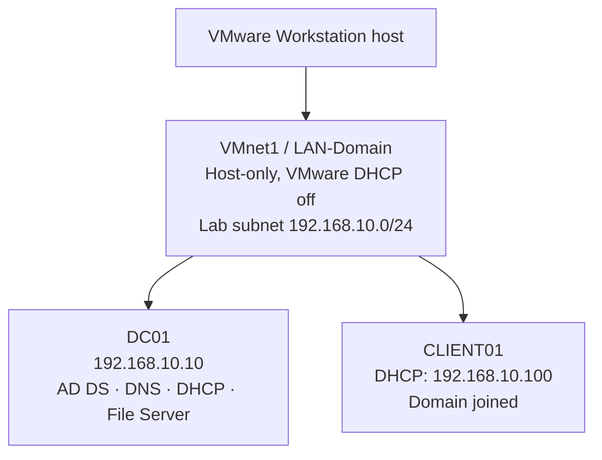
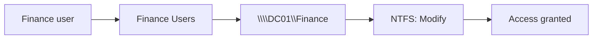
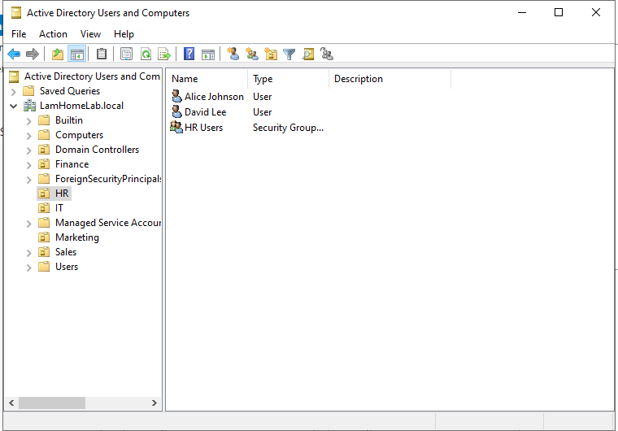
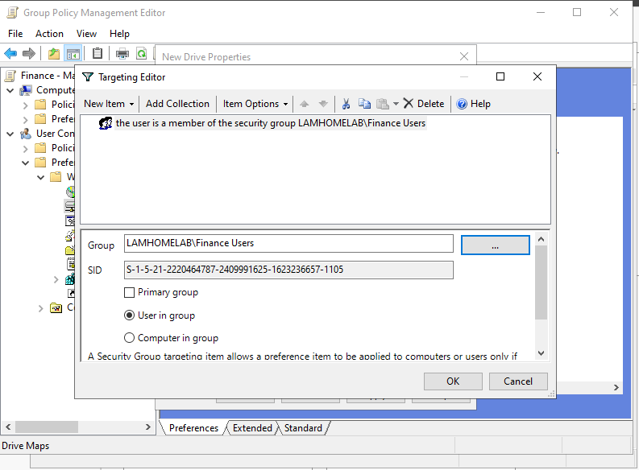
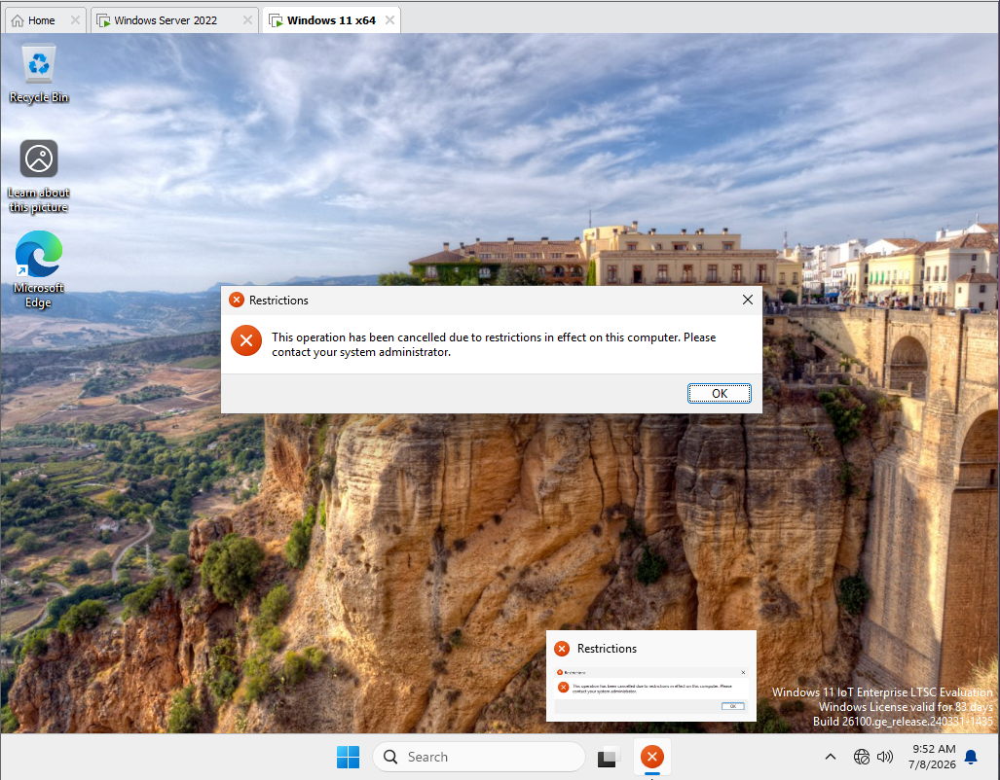

# Windows Server 2022 Active Directory Homelab

An enterprise-style Windows infrastructure lab built in VMware Workstation to demonstrate practical IT support and junior systems administration skills. The environment uses a Windows Server 2022 domain controller and a domain-joined Windows 11 client to implement centralised identity, DNS, DHCP, file access, Group Policy, software deployment, and account security.

This repository documents both the working configuration and the troubleshooting process. All names, addresses, and screenshots relate to an isolated lab environment.

**Visual walkthrough:** [`index.html`](index.html) is a single-page tour of the lab with the architecture diagram, build timeline, access model, case studies, and clickable screenshots. Open it locally, or view it on [GitHub Pages](https://zsunnn.github.io/windows-server-2022-active-directory-homelab/).

## Skills demonstrated

- Active Directory Domain Services administration
- DNS and DHCP configuration and validation
- Organisational Unit and security-group design
- SMB sharing and NTFS role-based access control
- Group Policy linking, filtering, and troubleshooting
- Network-drive mapping and MSI software deployment
- Account lockout investigation and PowerShell recovery
- VMware host-only networking and multi-NIC troubleshooting
- Evidence-based validation and technical documentation

## Architecture

| System | Configuration |
|---|---|
| `DC01` | Windows Server 2022; AD DS, DNS, DHCP, File Server |
| `CLIENT01` | Windows 11 IoT Enterprise LTSC Evaluation (24H2); domain joined |
| Domain | `LamHomeLab.local` |
| Network | VMware VMnet1 host-only (VMware DHCP off); lab subnet `192.168.10.0/24` served by Windows DHCP |
| DC/DNS | `192.168.10.10` |
| DHCP scope | `192.168.10.100`–`192.168.10.200` |
| Client lease | `192.168.10.100` |

Both virtual machines use one host-only adapter. The temporary NAT adapters used during troubleshooting were removed from the final topology.

## Implementation highlights

### Active Directory and access model

Departmental OUs and security groups represent Finance, HR, IT, Marketing, and Sales. User access is granted through group membership rather than direct per-user permissions.

### File services

The Finance share is stored at `C:\CompanyShares\Finance`, published as `\\DC01\Finance`, and mapped as drive `F:` for authorised Finance users. Validation confirmed that a Finance user could access the share while an IT user was denied.

### Group Policy

- Finance drive mapping with item-level targeting for `Finance Users`
- Control Panel restriction applied through `GG_ControlPanel_Restricted`
- 7-Zip MSI assigned through Computer Configuration
- Password and account lockout controls through domain policy

### DHCP

Windows Server DHCP supplies client configuration on the isolated host-only segment. VMware DHCP is disabled for the lab network.

## Validation summary

| Area | Validation | Screenshot evidence |
|---|---|---|
| Domain | `CLIENT01` joined `LamHomeLab.local` | Join dialog; domain account signed in on the client |
| DNS | Forward lookup zone present; hostname lookup and ping tested | Zones and records; command output not captured |
| File server | Finance access allowed; unauthorised IT access denied | Folder structure and share permissions; test results not captured |
| Drive mapping | Finance share appeared as `F:` | Item-level targeting and `gpresult`; `F:` not captured |
| Group Policy | `gpresult` used; Control Panel restriction verified | Yes |
| Software | 7-Zip installation verified on the client | Installed app; GPO package settings not captured |
| Account security | Lockout reproduced; account unlocked using GUI and PowerShell | Lockout screen, ADUC unlock, `Search-ADAccount`; `Unlock-ADAccount` output not captured |
| DHCP | Scope, binding, options, lease, and client address validated | Yes |

See the [evidence index](docs/validation.md) for the screenshots supporting each result and the steps that were performed without a screenshot.

## Troubleshooting case studies

- [GPO read-permission failure](troubleshooting/gpo-read-permission.md)
- [Finance drive mapping](troubleshooting/drive-mapping.md)
- [DHCP and multi-NIC failure](troubleshooting/dhcp-multinic.md)

The DHCP incident was particularly valuable: the client received an APIPA address and the server recorded no DHCP Discover traffic. After validating the scope, service, binding, and VMware configuration, the topology was simplified to one host-only NIC per VM. The client then obtained a Windows Server DHCP lease successfully.

## Repository guide

- [`index.html`](index.html) — visual walkthrough of the lab (diagram, timeline, evidence)
- [`docs/`](docs/) — implementation and validation documentation
- [`troubleshooting/`](troubleshooting/) — incident-style case studies
- [`diagrams/`](diagrams/) — reusable Mermaid architecture diagrams
- [`scripts/`](scripts/) — commands used to validate and administer the lab
- [`screenshots/`](screenshots/) — curated implementation evidence

## Lessons learned

The main learning outcome was that a successful infrastructure deployment requires more than installing roles. Group Policy scope and permissions, the interaction between share and NTFS permissions, DHCP broadcast boundaries, and virtual-network topology all need to be validated from the client and server perspectives.

Read the detailed [lessons learned](docs/lessons-learned.md).

## Scope and limitations

- This is an isolated homelab, not a production deployment.
- The domain uses the `.local` namespace for lab purposes.
- High availability, backups, monitoring, patch management, PKI, and cloud integration are outside the current scope.
- A USB restriction policy was explored but is not presented as completed because it was not fully validated.
- Some validation steps (marked in the table above) were performed without a saved screenshot, so the repository does not include evidence for them.

## Author note

This project was prepared as technical evidence for IT Support, Service Desk, Desktop Support, and Junior Systems Administrator opportunities in Australia.

