# Homelab Walkthrough

A visual tour of the lab: what was built, in what order, how access works, and what went wrong along the way. Click any screenshot to open it at full size.

> An interactive version of this page is available on [GitHub Pages](https://zsunnn.github.io/windows-server-2022-active-directory-homelab/). The repository's [README](README.md) has the summary and the [evidence index](docs/validation.md) lists every screenshot.

| | |
|---|---|
| **Domain** | `LamHomeLab.local` |
| **DC01** | Windows Server 2022: AD DS, DNS, DHCP, file services |
| **CLIENT01** | Windows 11 IoT Enterprise LTSC Evaluation (24H2), domain joined |
| **Network** | VMware VMnet1 host-only, VMware DHCP off, lab subnet `192.168.10.0/24` |
| **At a glance** | 2 VMs · 5 department OUs · 4 Group Policy controls · 3 case studies · 36 screenshots |

## Contents

1. [Architecture](#1-architecture)
2. [Identity and access](#2-identity-and-access)
3. [Build timeline](#3-build-timeline)
4. [Troubleshooting](#4-troubleshooting)
5. [Validation](#5-validation)

---

## 1. Architecture

Everything runs on one VMware Workstation host. The final design is one isolated Layer 2 segment where Windows Server provides DNS, DHCP and AD to the client.

### Final design

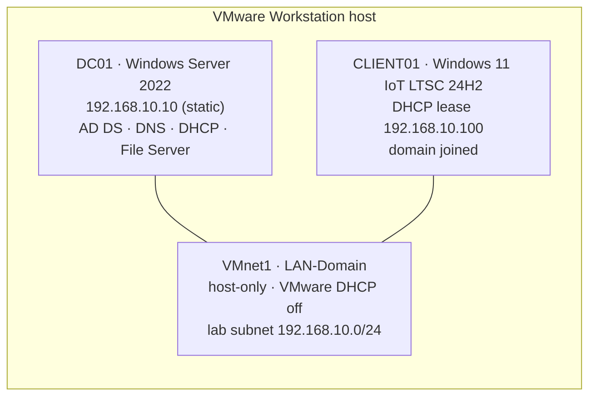

What CLIENT01 gets from DC01 over this segment:

| Service | Purpose |
|---|---|
| DNS | Name resolution for `LamHomeLab.local` |
| DHCP | Leases `192.168.10.100` – `192.168.10.200` (101 addresses) |
| AD DS | Domain sign-in |
| Group Policy | Drive mapping, Control Panel restriction, 7-Zip deployment |
| SMB | `\\DC01\Finance` |

### Initial build, before the DHCP incident

Each VM first had a second, temporary NAT adapter to reach installation media. This is the configuration behind the [DHCP case study](#case-1--dhcp-and-multi-nic).

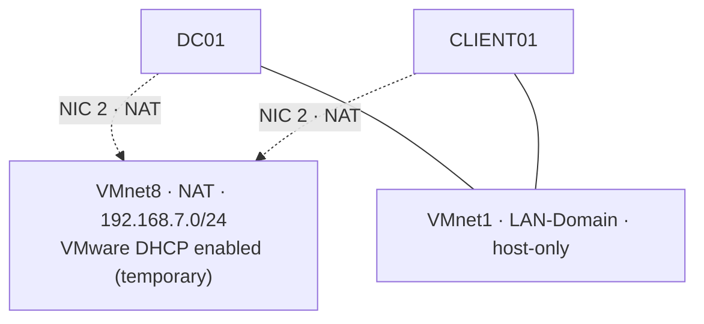

<a href="screenshots/00-vm-setup/01-dc01-vm-settings.png"></a>
<a href="screenshots/08-dhcp-networking/06-vmnet1-host-only-final.png"></a>

*Left: DC01 VM settings during the initial build (4 GB RAM, 2 vCPU, 60 GB disk, NAT adapter). Right: the Virtual Network Editor, with VMnet1 host-only and DHCP off.*

---

## 2. Identity and access

Departments are Organisational Units. Access is granted to security groups, never to individual users, so onboarding someone means adding them to a group.

```text
LamHomeLab.local
├── Finance
├── HR            (sample users, HR Users group)
├── IT
├── Marketing
├── Sales
├── Group
└── Builtin · Computers · Domain Controllers · Users
```

Security groups: `Finance Users`, `HR Users`, `IT Users`, `Marketing Users`, `Sales Users`, `GG_ControlPanel_Restricted`.
`GG_ControlPanel_Restricted` contains the Finance, HR, Marketing and Sales groups. `IT Users` is left out so IT keeps access to administrative tools.

### Finance share: from user to file

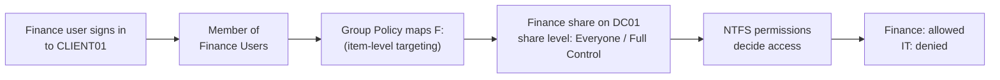

The effective permission is the most restrictive combination of share and NTFS. Both the allowed (Finance) and denied (IT) outcomes were tested on screen.

---

## 3. Build timeline

Ten phases, in the order they were done. Badges show what evidence exists: ✅ verified, 🟡 partial, 📄 documented, ⚪ performed but not captured.

### 00 · Build the virtual machines ✅

Create the two VMs the rest of the lab depends on.

- DC01: Windows Server 2022, 4 GB RAM, 2 vCPU, 60 GB disk. The first build used a NAT adapter for installation media.
- CLIENT01: Windows 11 IoT Enterprise LTSC Evaluation 24H2, a clean machine before joining the domain.
- Roles were added with Server Manager's Add Roles and Features wizard.

<a href="screenshots/00-vm-setup/02-add-roles-file-storage.png">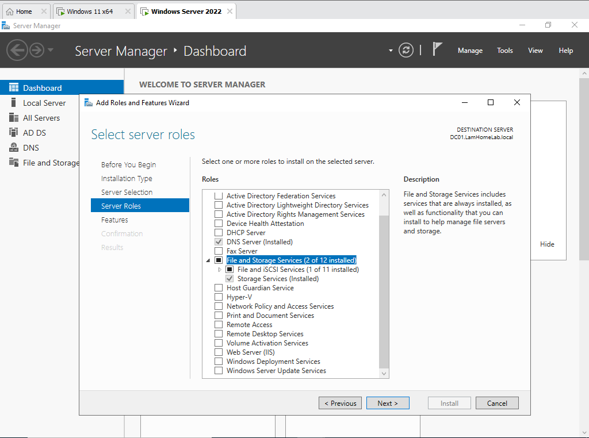</a>
<a href="screenshots/00-vm-setup/03-client01-this-pc-baseline.png">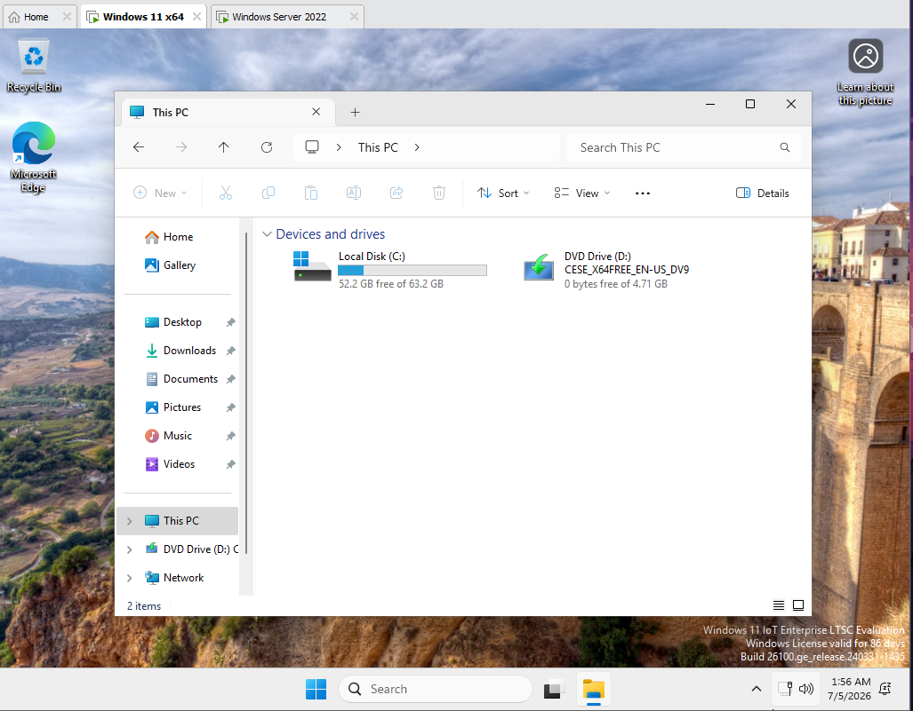</a>

*Add Roles and Features wizard on DC01 · CLIENT01 before joining the domain.*

### 01 · Active Directory: domain, OUs and groups ✅

Promote DC01 and model the company with one OU and one security group per department. `GG_ControlPanel_Restricted` groups the four non-IT groups so a single policy can target them.

<a href="screenshots/01-active-directory/01-ou-structure-hr-users.png"></a>
<a href="screenshots/05-gpo-control-panel/03-restricted-group-members.png">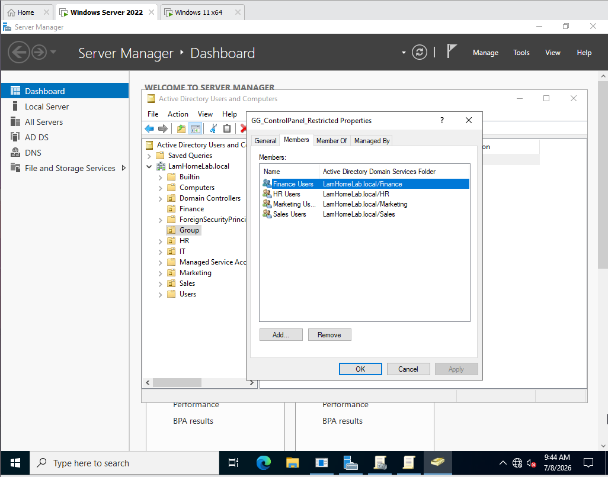</a>

*OU structure with HR expanded · members of `GG_ControlPanel_Restricted`.*

### 02 · DNS and domain join 🟡

- Forward lookup zone `LamHomeLab.local` with `_msdcs`, Active Directory integrated.
- DC01 resolves to `192.168.10.10`.
- CLIENT01 uses the DC as its DNS server and was joined to the domain.

Not captured: `nslookup` and `ping dc01` from the client were run and checked on screen. The join dialog capture shows the workflow, not the completed join.

<a href="screenshots/02-dns-domain-join/01-dns-forward-lookup-zones.png"></a>
<a href="screenshots/02-dns-domain-join/03-dns-dc01-records.png">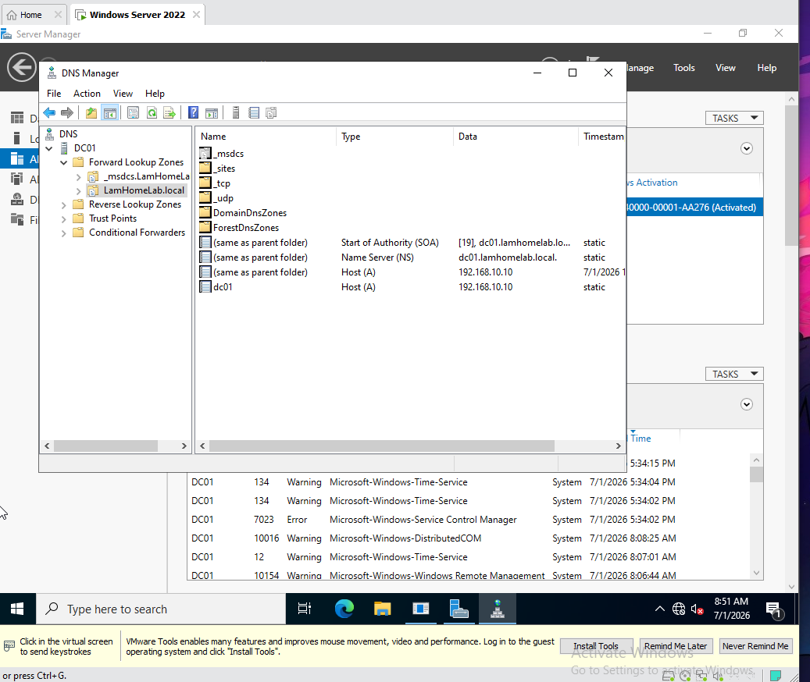</a>
<a href="screenshots/02-dns-domain-join/02-client-domain-join-dialog.png">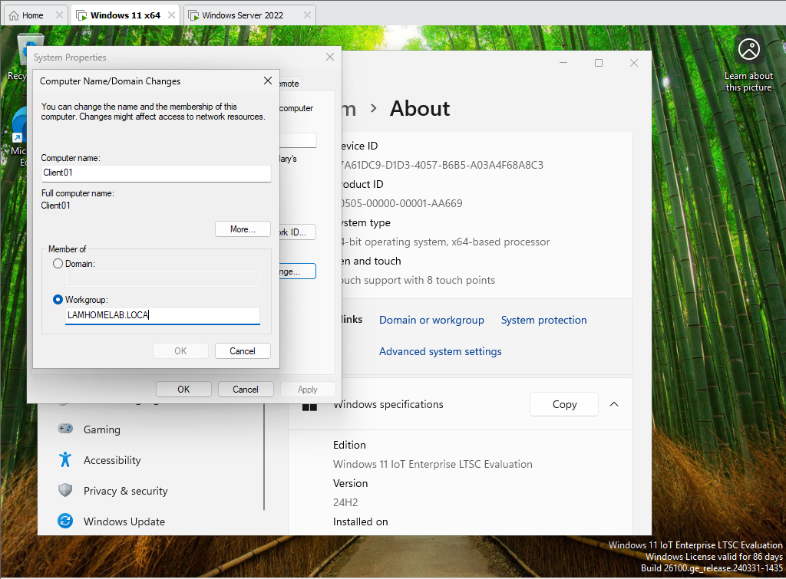</a>

*DNS zones · records in the zone (host `dc01` → 192.168.10.10) · domain-join dialog on CLIENT01.*

### 03 · File server and shares 🟡

- Folders under `C:\CompanyShares`: Finance, HR, IT, Marketing, Sales.
- Finance published as `\\DC01\Finance`. Share level is Everyone / Full Control, so NTFS does the restricting.
- `Finance Users` added to the NTFS permissions. Removing the inherited `Users` entry required turning inheritance off first.

Not captured: the final NTFS permission list and the allowed / denied test results. The two NTFS images are low-resolution crops.

<a href="screenshots/03-file-server/01-companyshares-folder-structure.png"></a>
<a href="screenshots/03-file-server/02-finance-share-permissions.png"></a>
<a href="screenshots/extras/ntfs-select-finance-users.png"></a>

*Department folders · share tab for `\\DC01\finance` · adding `Finance Users` to NTFS permissions (low-res).*

### 04 · Group Policy: map the Finance drive 🟡

Map `\\DC01\Finance` as `F:` for Finance only, with no logon script. The GPO `Finance - Map Network Drive` uses a Drive Maps preference with item-level targeting: *the user is a member of the security group* `LAMHOMELAB\Finance Users`. The drive first failed to appear; the fix was targeting plus `gpupdate /force` and a fresh sign-in.

Not captured: `F:` in Explorer. `gpresult` lists the GPO as applied (see phase 05).

<a href="screenshots/04-gpo-drive-mapping/01-item-level-targeting-finance-users.png"></a>

### 05 · Group Policy: restrict Control Panel ✅

Block Control Panel for everyone except IT.

- GPO `Block - Control panel` linked at the domain: *Prohibit access to Control Panel and PC settings* = Enabled.
- Security filtering limited to `GG_ControlPanel_Restricted`.
- The first attempt did not apply because the target lacked **Read** on the GPO ([case 2](#case-2--gpo-read-permission)).
- After the fix, Control Panel is blocked for restricted users. The IT user's `whoami /groups` shows `IT Users` and not the restricted group.

<a href="screenshots/05-gpo-control-panel/01-control-panel-policy-enabled.png">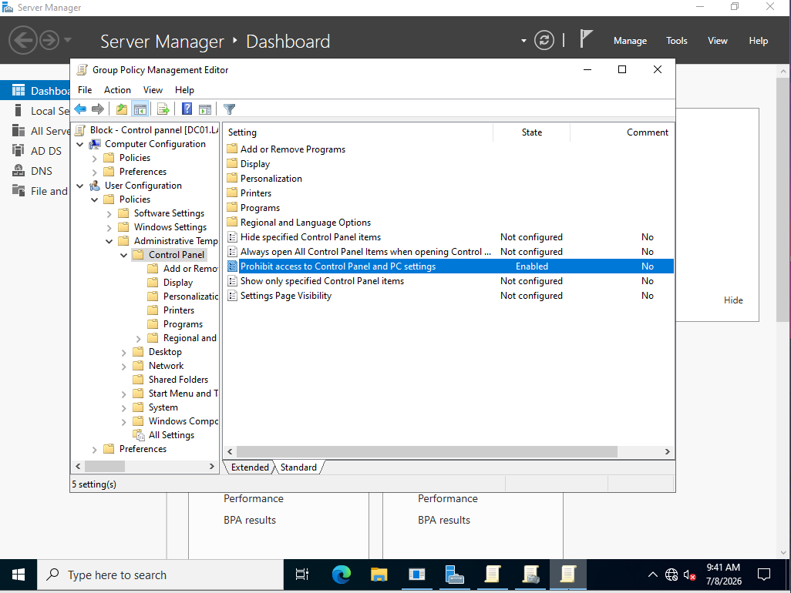</a>
<a href="screenshots/05-gpo-control-panel/02-security-filtering-policy-group.png">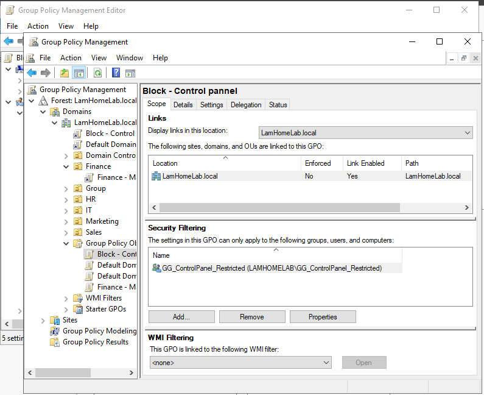</a>
<a href="screenshots/05-gpo-control-panel/04-gpresult-before-read-fix.png">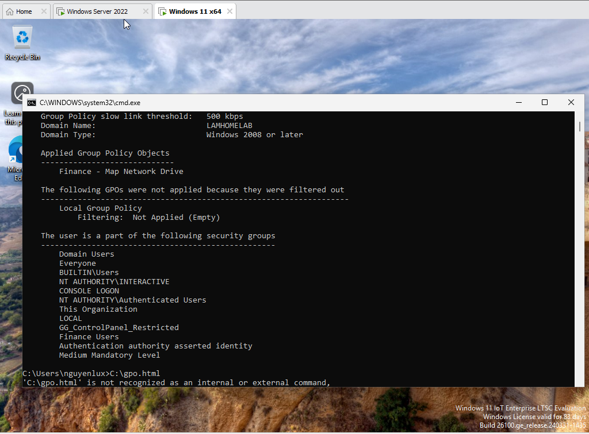</a>
<a href="screenshots/05-gpo-control-panel/05-control-panel-blocked-validation.png"></a>
<a href="screenshots/05-gpo-control-panel/06-whoami-groups-it-user.png">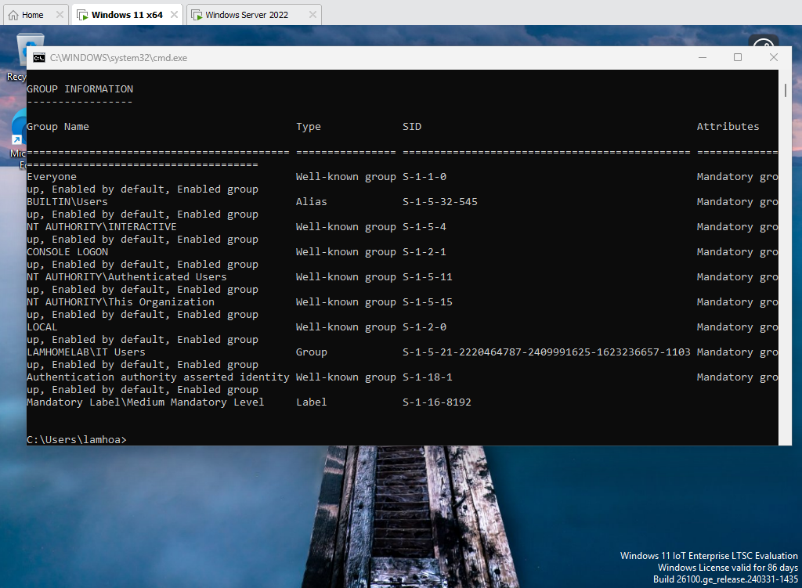</a>

*Policy enabled · security filtering · `gpresult` before the Read fix · Control Panel blocked · IT user's groups.*

### 06 · Account lockout and recovery 🟡

Reproduce a lockout as a user sees it, then recover the account as an administrator.

- Locked account on the client: "The referenced account is currently locked out and may not be logged on to."
- Recovery in ADUC: Reset Password with *Unlock the user's account*.
- PowerShell: `Search-ADAccount -LockedOut`. The first attempts failed with a parameter-set error until the switch was supplied.

Not captured: the lockout policy values and the output of `Unlock-ADAccount`.

<a href="screenshots/06-account-security/01-account-locked-message.png">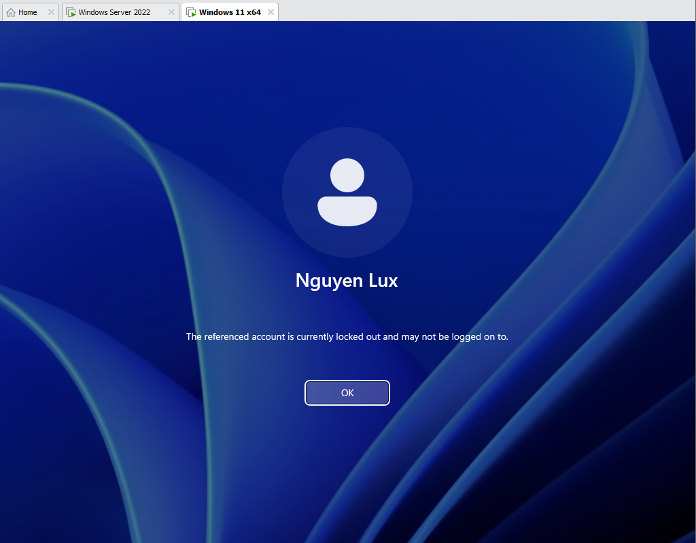</a>
<a href="screenshots/06-account-security/02-aduc-reset-password-unlock.png">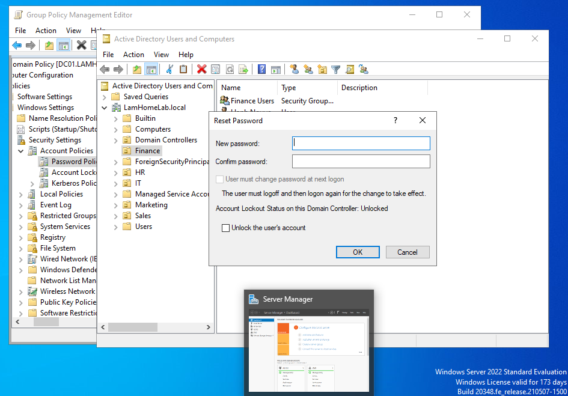</a>
<a href="screenshots/06-account-security/03-powershell-search-adaccount.png">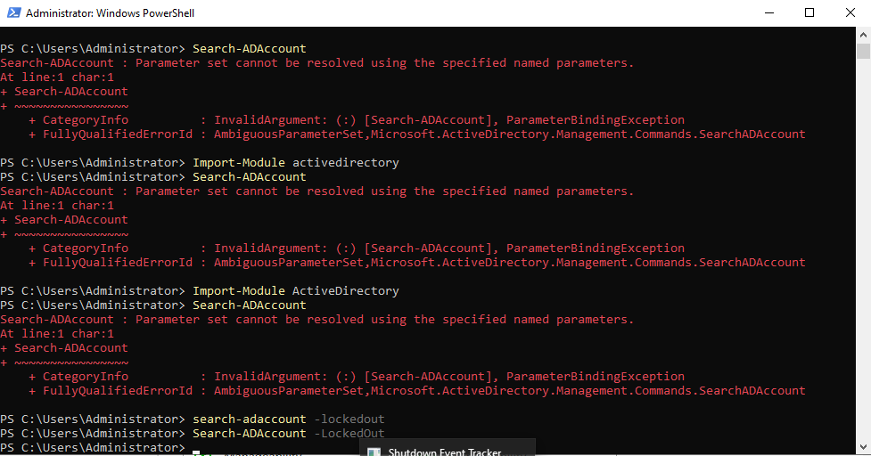</a>

### 07 · Software deployment with Group Policy 🟡

7-Zip MSI assigned through *Computer Configuration → Software Installation*. 7-Zip 26.02 (x64) appears in the client's Installed apps. The package settings in the GPO were not captured, and the MSI is not stored in this repository.

<a href="screenshots/07-software-deployment/01-7zip-installed-validation.png">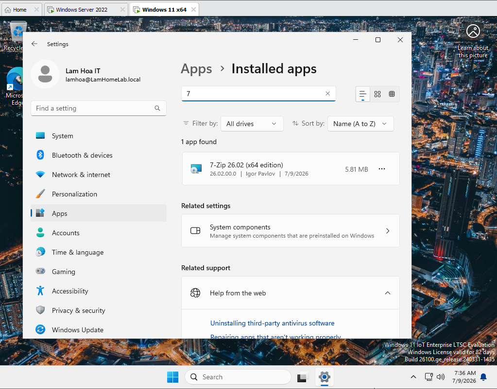</a>

### 08 · DHCP and network design ✅

- DHCP role on DC01, scope `192.168.10.0/24`, range `.100` – `.200`.
- Server bound to the `LAN-Domain` adapter at `192.168.10.10`.
- Scope options include 006 (DNS servers) and 015 (DNS domain name `LamHomeLab.local`). The capture also lists further entries.
- CLIENT01 receives `192.168.10.100` and the lease shows on DC01.

<a href="screenshots/08-dhcp-networking/01-dhcp-manager-installed.png">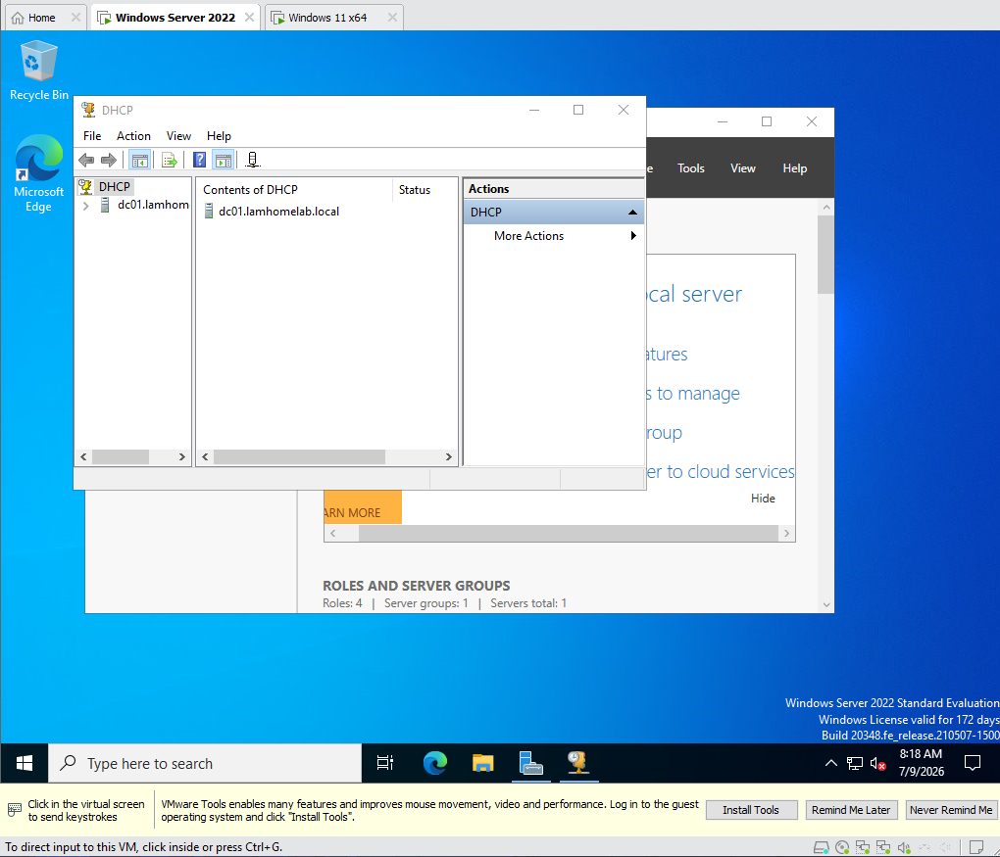</a>
<a href="screenshots/08-dhcp-networking/02-dhcp-scope-created.png"></a>
<a href="screenshots/08-dhcp-networking/03-dhcp-binding-lan-domain.png"></a>
<a href="screenshots/08-dhcp-networking/04-dhcp-scope-options.png"></a>
<a href="screenshots/08-dhcp-networking/05-dhcp-lease-success-client01.png"></a>

*DHCP console · scope · binding on `LAN-Domain` · scope options · lease to Client01.*

### 09 · Troubleshooting the DHCP failure 📄

The client received a `169.254.x.x` address and the server never saw its requests. The investigation is below.

---

## 4. Troubleshooting

### Case 1 · DHCP and multi-NIC

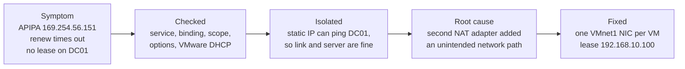

What the checks showed:

- ✅ `Get-Service DHCPServer`: Running.
- ✅ `Get-DhcpServerv4Binding`: `LAN-Domain`, `192.168.10.10`, True.
- ✅ One scope, 101 addresses, none in use.
- ❌ `Get-DhcpServerv4Statistics`: **Discovers = 0**, the server never received a request.
- ❌ `ipconfig /renew`: the request timed out.

The server was healthy and listening, yet it counted zero Discover packets, which moved the problem from the DHCP configuration to the network path. The evidence supports a topology / broadcast-domain fault; it does not by itself prove a duplicate-address conflict. The adapter-removal step was not captured; the failing and final states were.

<a href="screenshots/09-troubleshooting/01-client-apipa-address.png"></a>
<a href="screenshots/09-troubleshooting/04-dhcp-binding-check.png"></a>
<a href="screenshots/09-troubleshooting/06-dhcp-statistics-no-discovers.png"></a>
<a href="screenshots/09-troubleshooting/05-dhcp-renew-timeout.png"></a>
<a href="screenshots/09-troubleshooting/03-static-ip-restored-connectivity.png"></a>
<a href="screenshots/09-troubleshooting/02-dhcp-service-running.png"></a>

*APIPA address · binding check · zero Discovers · renew timeout · static-IP ping (first attempt times out, then 4 of 4 replies) · service running.*

**Takeaway:** DHCP depends on broadcasts, so it depends on topology. When the server shows no Discovers, look at the network path before the scope. Full write-up: [dhcp-multinic.md](troubleshooting/dhcp-multinic.md).

### Case 2 · GPO Read permission

A restricted user could still open Control Panel even though the GPO was enabled, linked and security filtered.

| Step | What happened |
|---|---|
| Symptom | The policy was configured, yet Control Panel opened |
| Checked | Policy setting, user's OU and groups, `gpupdate /force`, `gpresult /r`, GPO delegation |
| Found | The Control Panel GPO was missing from the user's applied-policy list |
| Root cause | The filtered target had no **Read** permission on the GPO, so it could not process it |
| Fixed | Read restored, Apply Group Policy kept. After a new session, Control Panel was blocked |

<a href="screenshots/05-gpo-control-panel/04-gpresult-before-read-fix.png"></a>
<a href="screenshots/05-gpo-control-panel/05-control-panel-blocked-validation.png"></a>

**Takeaway:** check scope, Read and Apply Group Policy as three separate conditions, and use `gpresult` to confirm what applied. Full write-up: [gpo-read-permission.md](troubleshooting/gpo-read-permission.md).

### Case 3 · Finance drive mapping

`F:` did not appear after `gpupdate /force` and a sign-out / sign-in. The GPO link and the user's Finance group membership were verified, and item-level targeting on `Finance Users` was added. The drive then appeared as `F:`, and `gpresult` lists the GPO as applied. A screenshot of `F:` in Explorer was not captured.

**Takeaway:** after changing policy, refresh and start a new user session before judging the result. Full write-up: [drive-mapping.md](troubleshooting/drive-mapping.md).

---

## 5. Validation

| Area | Evidence | Status |
|---|---|---|
| AD structure and departmental objects | [OU structure](screenshots/01-active-directory/01-ou-structure-hr-users.png), [group members](screenshots/05-gpo-control-panel/03-restricted-group-members.png) | ✅ Verified |
| DNS zone and DC record | [zones](screenshots/02-dns-domain-join/01-dns-forward-lookup-zones.png), [records](screenshots/02-dns-domain-join/03-dns-dc01-records.png) | ✅ Verified |
| Domain-join workflow | [join dialog](screenshots/02-dns-domain-join/02-client-domain-join-dialog.png) | 📄 Workflow captured |
| Hostname lookup and ping | None | ⚪ Performed, not captured |
| Finance share and share permissions | [folders](screenshots/03-file-server/01-companyshares-folder-structure.png), [share tab](screenshots/03-file-server/02-finance-share-permissions.png) | ✅ Verified |
| Finance NTFS permissions | [select group](screenshots/extras/ntfs-select-finance-users.png), [inheritance warning](screenshots/extras/ntfs-inheritance-error.png) | 🟡 Partial |
| Finance allowed, IT denied | None | ⚪ Performed, not captured |
| Finance drive mapped to `F:` | [targeting](screenshots/04-gpo-drive-mapping/01-item-level-targeting-finance-users.png), [gpresult](screenshots/05-gpo-control-panel/04-gpresult-before-read-fix.png) | 🟡 Partial |
| Control Panel restriction | [policy](screenshots/05-gpo-control-panel/01-control-panel-policy-enabled.png), [filtering](screenshots/05-gpo-control-panel/02-security-filtering-policy-group.png), [blocked](screenshots/05-gpo-control-panel/05-control-panel-blocked-validation.png) | ✅ Verified |
| Account lockout and recovery | [locked](screenshots/06-account-security/01-account-locked-message.png), [ADUC unlock](screenshots/06-account-security/02-aduc-reset-password-unlock.png), [PowerShell](screenshots/06-account-security/03-powershell-search-adaccount.png) | 🟡 Partial |
| 7-Zip deployment | [Installed apps](screenshots/07-software-deployment/01-7zip-installed-validation.png) | 🟡 Install verified |
| DHCP scope, binding and options | [scope](screenshots/08-dhcp-networking/02-dhcp-scope-created.png), [binding](screenshots/08-dhcp-networking/03-dhcp-binding-lan-domain.png), [options](screenshots/08-dhcp-networking/04-dhcp-scope-options.png) | ✅ Verified |
| Successful DHCP lease | [lease](screenshots/08-dhcp-networking/05-dhcp-lease-success-client01.png) | ✅ Verified |
| APIPA / no-Discover incident | [statistics](screenshots/09-troubleshooting/06-dhcp-statistics-no-discovers.png) and five more captures | 📄 Documented |

### Scope and limitations

- This is an isolated homelab, not a production deployment. The `.local` namespace is used for lab purposes.
- High availability, backups, monitoring, patch management, PKI and cloud integration are out of scope.
- A USB restriction policy was explored but is not presented as complete because it was not fully validated.
- Not covered by a screenshot: the final NTFS ACL, `F:` in Explorer, the GPO software package settings and the account lockout policy values.

More detail: [implementation docs](docs/) · [case studies](troubleshooting/) · [scripts](scripts/) · [lessons learned](docs/lessons-learned.md)
