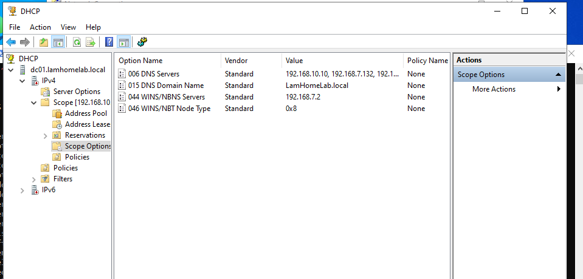

# Active Directory

## Domain

- Forest/domain: `LamHomeLab.local`
- Domain controller: `DC01`
- Client: `CLIENT01`

## Organisational structure

```text
LamHomeLab.local
├── Finance
├── HR
├── IT
├── Marketing
├── Sales
├── Group
└── Users
```

Known lab accounts include `lamhoa` in IT and `nguyenlux` and `hnbui` in Finance. Additional HR, Marketing, and Sales accounts exist but are intentionally not listed until their names are revalidated in ADUC.

## Security groups

- `Finance Users`
- `IT Users`
- `HR Users`
- `Marketing Users`
- `Sales Users`
- `GG_ControlPanel_Restricted`

`GG_ControlPanel_Restricted` contains the Finance, HR, Marketing, and Sales groups. `IT Users` is excluded so that IT retains access to administrative tools.




