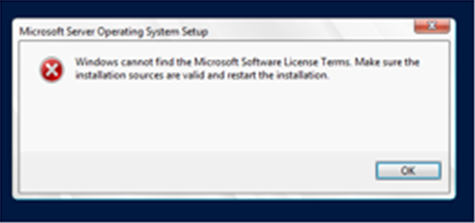

# Architecture

## Final topology

The final environment uses VMware VMnet1 as an isolated host-only network named `LAN-Domain`. Both virtual machines have one network adapter. NAT adapters used temporarily to obtain installation media were removed.

VMware's own subnet for VMnet1 is `192.168.230.0/24` with VMware DHCP turned off. The lab addressing below (`192.168.10.0/24`) is configured on the guests and served by Windows Server DHCP.

| Setting | DC01 | CLIENT01 |
|---|---|---|
| Adapter | LAN-Domain / VMnet1 | LAN-Domain / VMnet1 |
| Addressing | Static | DHCP |
| IPv4 address | `192.168.10.10` | `192.168.10.100` |
| Subnet mask | `255.255.255.0` | `255.255.255.0` |
| Default gateway | `192.168.10.1` | `192.168.10.1` |
| DNS | `127.0.0.1` | `192.168.10.10` |

The DC hosts AD DS, DNS, DHCP, and file services. `CLIENT01` runs Windows 11 IoT Enterprise LTSC Evaluation (24H2), is joined to `LamHomeLab.local`, and receives its network configuration from DC01.

## Design decisions

- One Layer 2 segment keeps domain DNS and DHCP behaviour predictable.
- The domain controller uses a static address.
- The client uses the Windows Server DHCP service.
- VMware DHCP is disabled on the lab segment.
- No secondary NAT NIC remains in the final design.

The gateway is retained in the documented configuration, although external routing is not a core requirement of the isolated lab.

## Initial build

During the initial build, DC01 was created with 4 GB RAM, 2 vCPU, a 60 GB disk and a NAT adapter to reach installation media. This is the temporary NAT configuration that was later removed (see the [DHCP case study](../troubleshooting/dhcp-multinic.md)).

Windows Server setup also reported a licence-terms error during installation (low-resolution crop):

