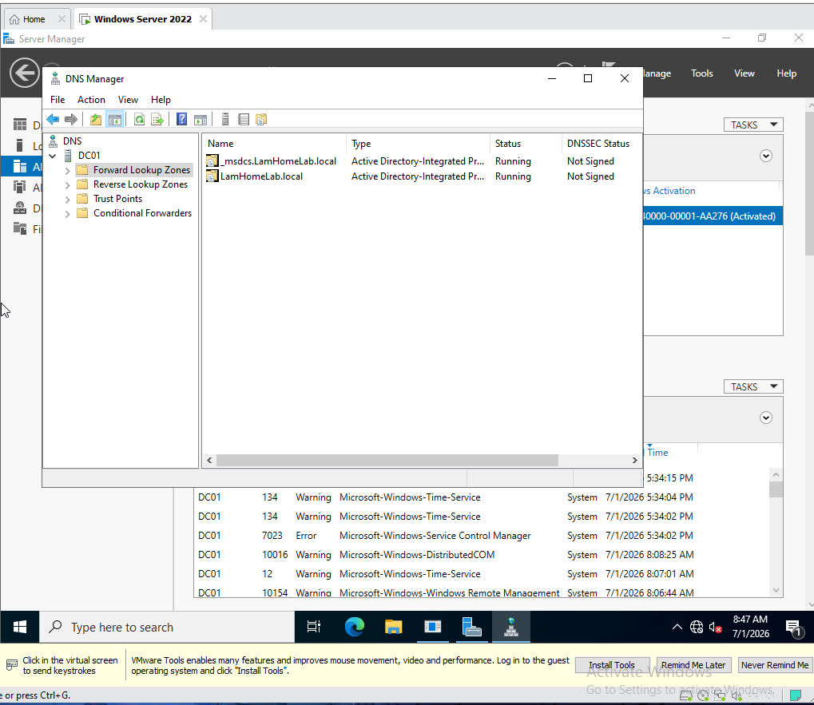
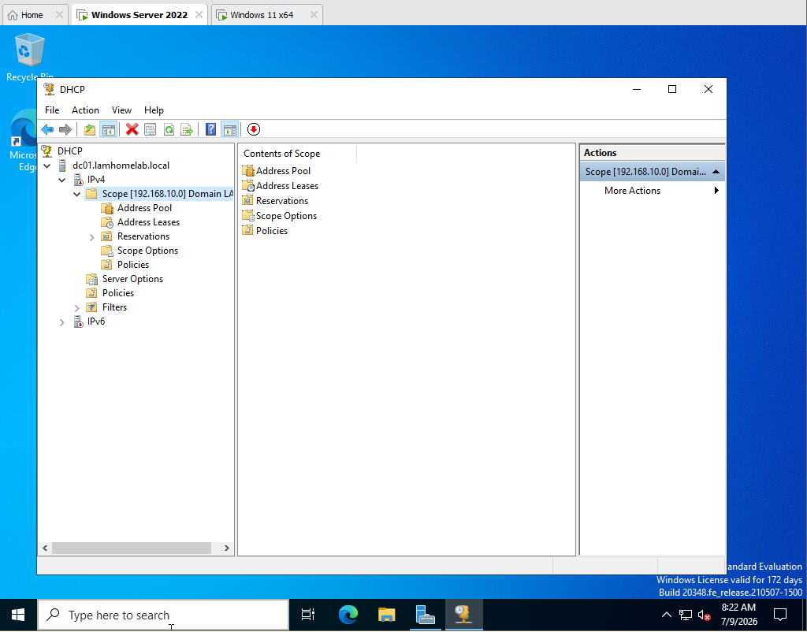
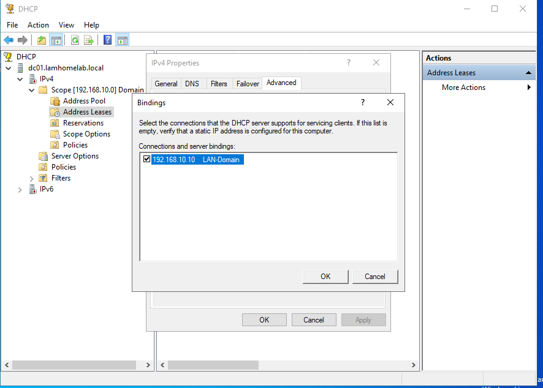
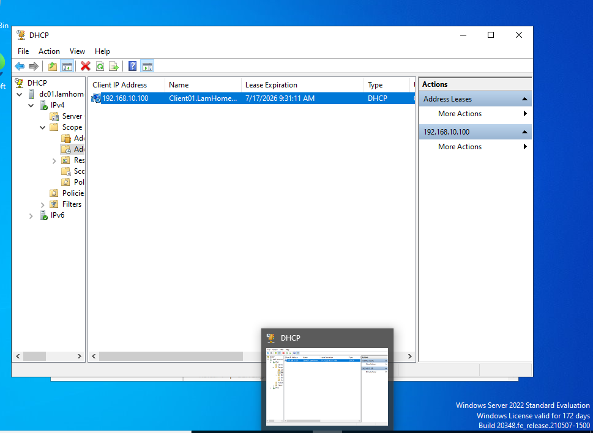

# DNS and DHCP

## DNS

DC01 hosts DNS for `LamHomeLab.local`. Domain clients use `192.168.10.10` as their DNS server so that domain service records and hostnames resolve through the domain controller.

Validation commands:

```powershell
nslookup dc01
nslookup client01
ping dc01
ping client01
```



## DHCP

| Setting | Value |
|---|---|
| Server | DC01 |
| Network | `192.168.10.0/24` |
| Scope | `192.168.10.100`–`192.168.10.200` |
| DNS option | `192.168.10.10` |
| Successful client lease | `192.168.10.100` |

The DHCP service is authorised and bound to the `LAN-Domain` adapter. VMware DHCP is disabled on VMnet1.







