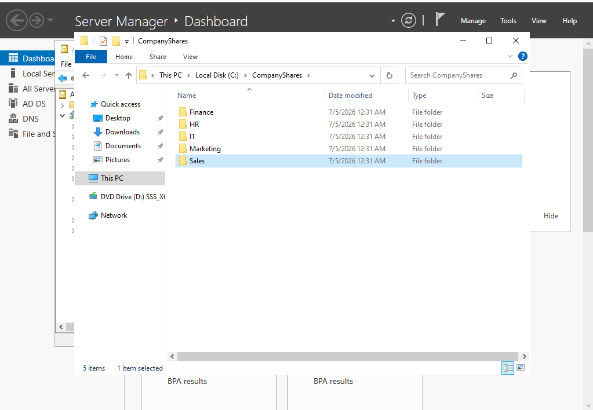
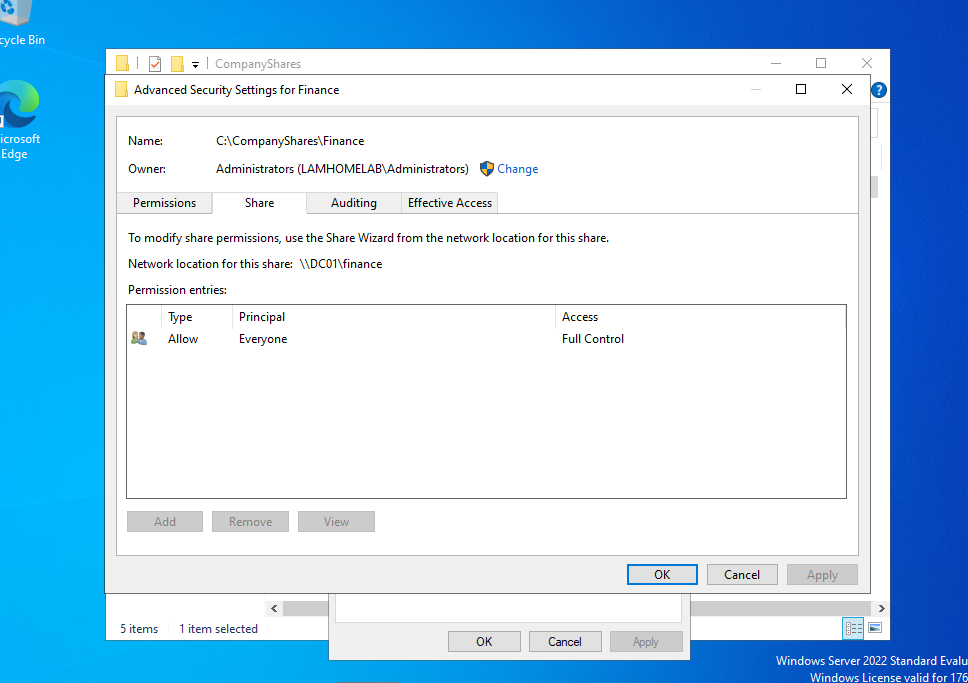
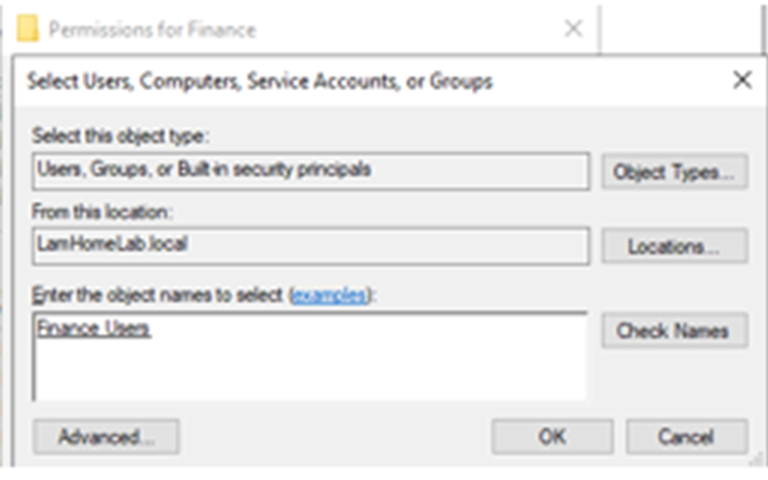
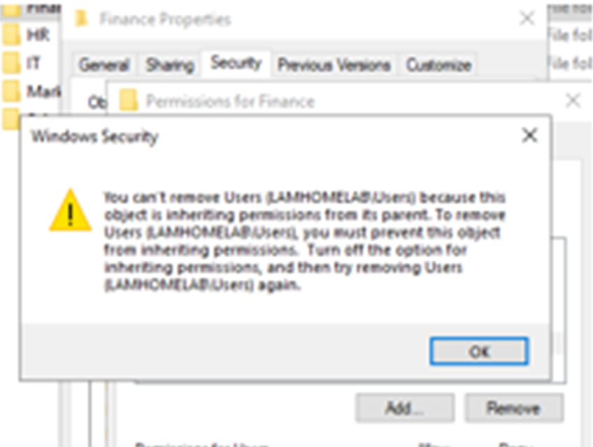

# File Services

## Finance share

| Property | Value |
|---|---|
| Physical path | `C:\CompanyShares\Finance` |
| Share name | `Finance` |
| UNC path | `\\DC01\Finance` |
| Mapped drive | `F:` |

Access follows a group-based model: Finance users receive the required NTFS and share access through `Finance Users`. Validation used separate Finance and IT identities to confirm both allowed and denied outcomes.

The allowed and denied test results and the final NTFS permission list were checked on screen but are not included as screenshots. The images below show the folder structure, the share-level permissions and two NTFS editing dialogs.

Share tab of the Finance folder: `\\DC01\finance`, with Everyone at Full Control at share level.

NTFS editing dialogs (low-resolution crops):

## Permission lesson

Effective access is the most restrictive combination of share and NTFS permissions. NTFS inheritance also needs to be understood before removing inherited principals or assigning departmental access.
