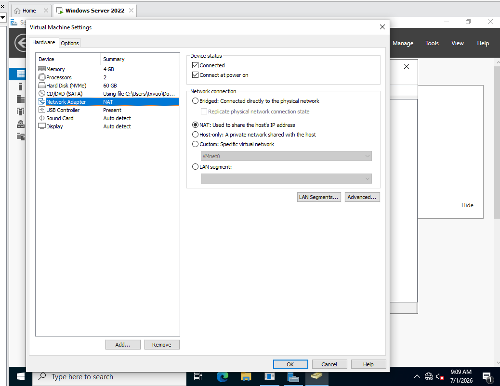

# File Services

## Finance share

| Property | Value |
|---|---|
| Physical path | `C:\CompanyShares\Finance` |
| Share name | `Finance` |
| UNC path | `\\DC01\Finance` |
| Mapped drive | `F:` |

Access follows a group-based model: Finance users receive the required NTFS and share access through `Finance Users`. Validation used separate Finance and IT identities to confirm both allowed and denied outcomes.

## Permission lesson

Effective access is the most restrictive combination of share and NTFS permissions. NTFS inheritance also needs to be understood before removing inherited principals or assigning departmental access.

