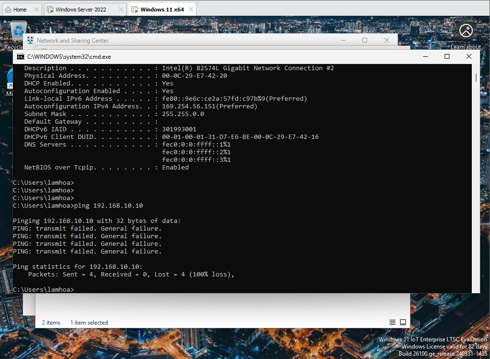
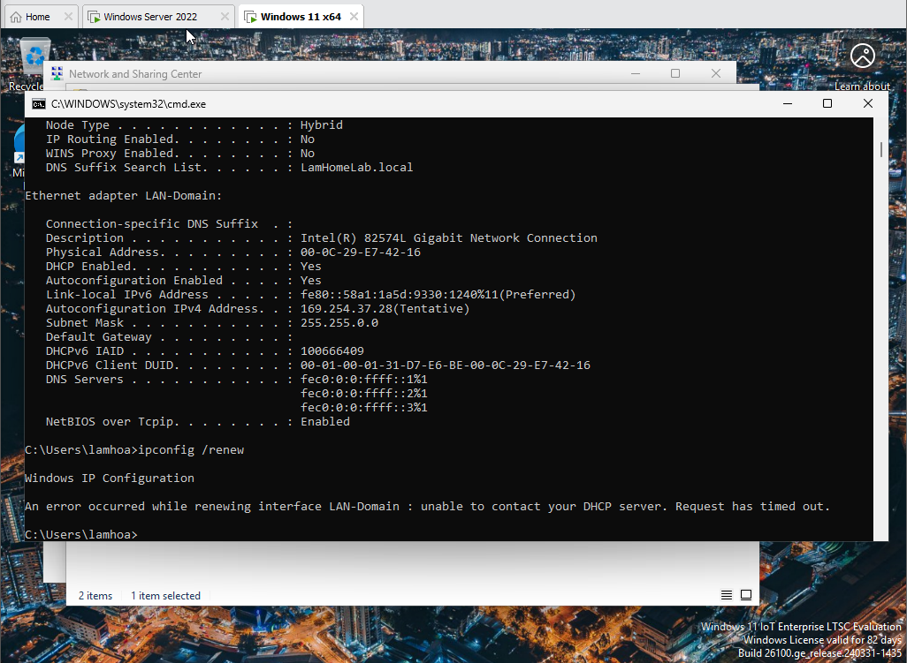
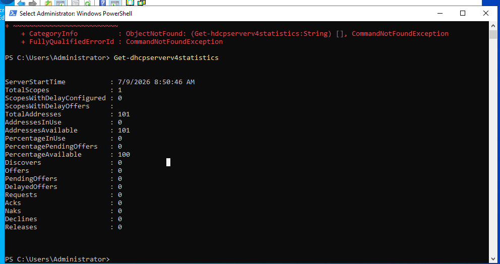
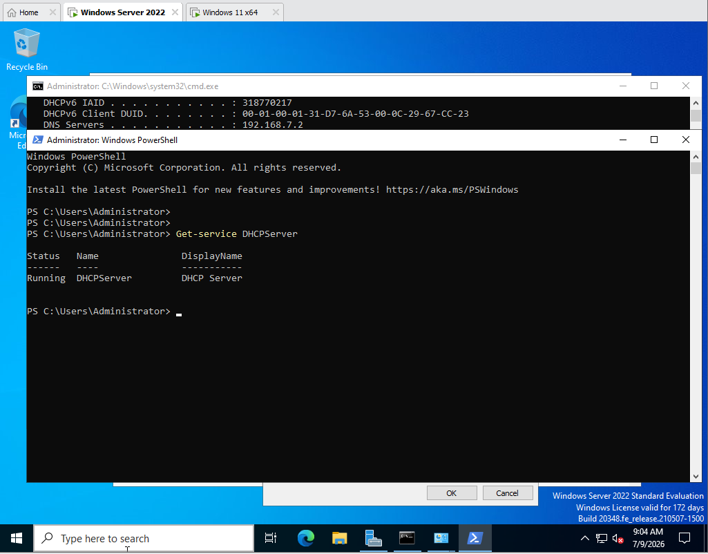
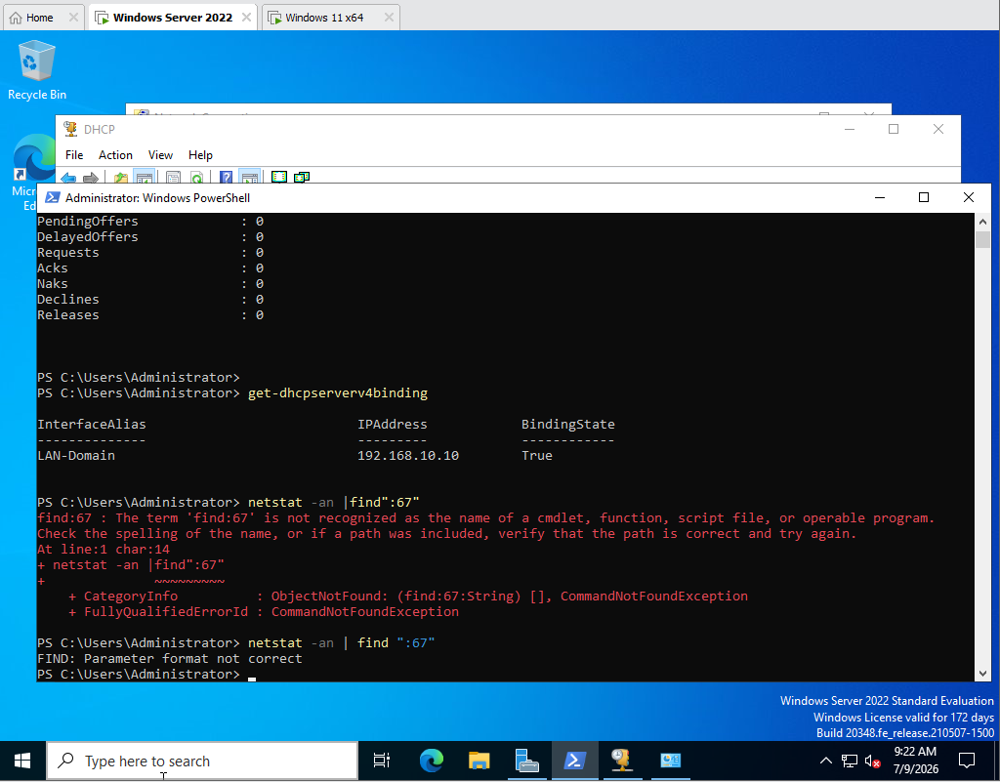
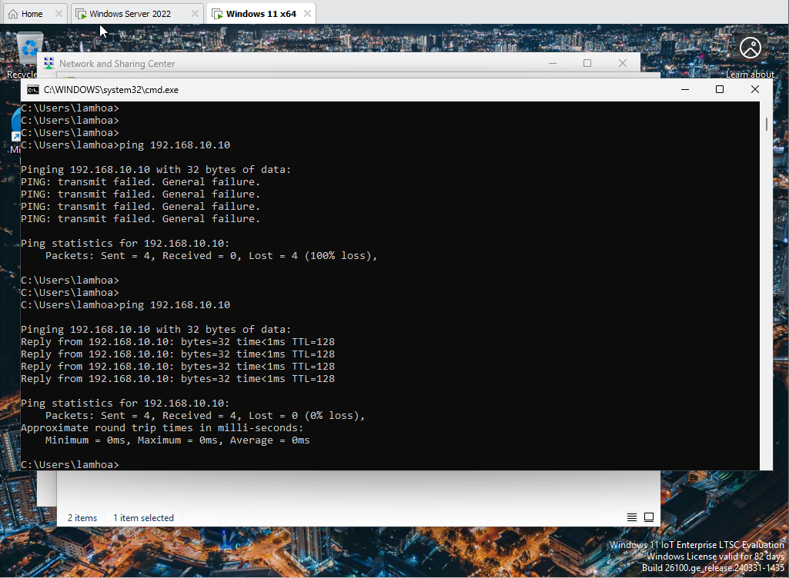

# Case Study: DHCP Failure After Multi-NIC Configuration

## Problem

`CLIENT01` failed to obtain a lease from DC01 after a second NAT adapter was introduced for temporary internet access.

Observed symptoms:

- APIPA address in the `169.254.0.0/16` range
- `ipconfig /renew` timeout
- no lease in the DC01 DHCP console
- no DHCP Discover traffic in server statistics

## Investigation

1. Checked DHCP service status, authorisation, scope, scope options, and binding.
2. Disabled VMware DHCP on the domain segment.
3. Confirmed connectivity using a temporary static address.
4. Compared the VM adapters and broadcast domains.
5. Removed the secondary NAT adapter and retained only VMnet1 host-only.

With a temporary static address the client could ping DC01 (first attempt fails, then 4 of 4 replies), which separated the problem from the server configuration:

## Root cause

The secondary adapter introduced an unintended network path and complicated DHCP broadcast delivery. The evidence supports a topology/broadcast-domain problem; it does not by itself prove a duplicate-address conflict.

## Resolution

- Kept one `LAN-Domain`/VMnet1 NIC on each VM.
- Removed the NAT adapters.
- Kept VMware DHCP disabled on VMnet1.
- Renewed the client configuration from Windows Server DHCP.

The screenshots capture the failing and final states. The adapter-removal step itself was not captured.

## Result

`CLIENT01` obtained `192.168.10.100`, and the lease appeared on DC01.

